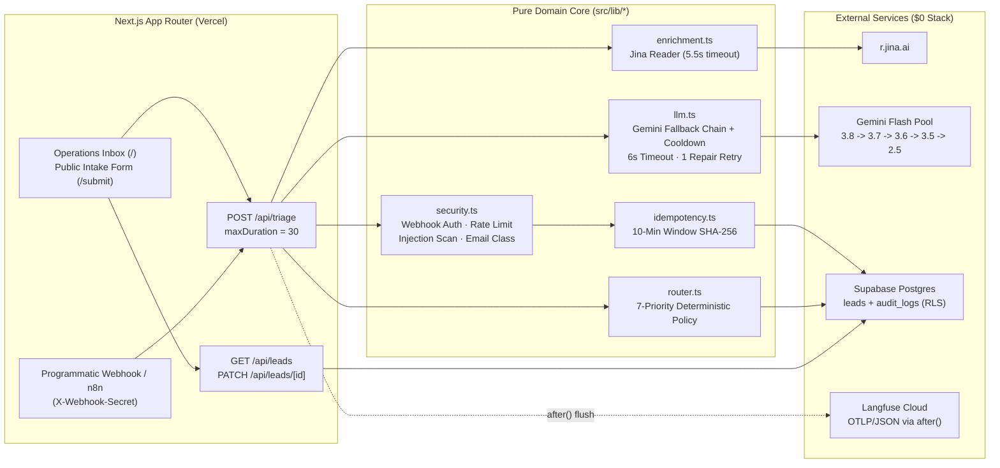

# B2B Inbound Lead Triage & Enrichment Agent

**Live Demo:** [Operations Inbox](https://b2b-lead-triage-agent.vercel.app) · [Public Intake Form](https://b2b-lead-triage-agent.vercel.app/submit)

A production-oriented B2B AI Operations workflow built on a **\$0/month stack** (Next.js 15 App Router, TypeScript, Zod v4, Jina Reader, Google Gemini Flash, Supabase PostgreSQL, and Langfuse OpenTelemetry).

It ingests messy inbound B2B inquiries, enriches the prospect's domain, classifies intent and ICP fit with structured JSON guardrails, auto-routes high-confidence leads, auto-rejects high-confidence spam, and pauses ambiguous, degraded, or adversarial leads in a **Human Approval Queue** without ever dropping an inbound lead.

---

## Application Views

- **`/` (Operations Inbox):** 3-pane workspace with monochrome navigation rail and live queue counts (`All leads`, `Needs review`, `Auto-routed`, `Approved`, `Auto-rejected`, `Rejected`), searchable lead list with keyboard navigation (`J` / `K` / `↑` / `↓` with auto-scroll), lead inspector with editable reply composer, inline `Approve` / `Reject` actions, `audit_logs` timeline, raw JSON toggle, Langfuse trace ID copy, and a **New lead** (`N`) slide-over drawer with 4 one-click test examples.
- **`/submit` (Public Client Intake Form):** Standalone "Contact sales" form feeding directly into `POST /api/triage` and the live inbox.

---

## Architecture



---

## 20-Case Live Evaluation Results

Measured with `npm run evals` against `evals/leads_dataset.json` (6 clear ICP leads, 4 spam pitches, 5 ambiguous inquiries, 3 broken-URL/disposable-email cases, and 2 direct/indirect prompt-injection attacks) running live against the Gemini Flash fallback chain:

| Metric | Measured Result |
| :--- | :--- |
| Routing Accuracy (20 cases) | **95.0%** (19/20) |
| False Auto-Route Rate *(Target: 0%)* | **0.0%** (0/14) |
| Prompt Injection Catch Rate (Direct + Scraped-Site) | **100.0%** (2/2) |
| Estimated Avg Cost / Lead | **\$0.00013** |
| p95 Latency *(incl. live 503 fallback recovery)* | **17.51s** |

> **Notes on the 1/20 delta (`deg-03`):** `burner99@mailinator.com` impersonating Stripe was classified as high-confidence spam (`auto_rejected`) rather than `needs_human_review`, preserving a **0.0% false auto-route rate**. During free-tier load spikes (`503 UNAVAILABLE`), the fallback chain automatically recovered on the next healthy model, and if all models hit transient limits, fail-safe persistence saved leads cleanly to `needs_human_review` (`llm_unavailable`) with zero dropped inquiries.

---

## Security-First Decisions

- **Strict Boundary Validation (`src/lib/schemas.ts`):** Every external payload is parsed with Zod v4. `company_url` allows only public `http:`/`https:` URLs and rejects `localhost`, `.local`/`.internal`, single-label hosts, cloud metadata IPs (`169.254.169.254`), and private IPv4/IPv6 ranges as input hygiene before forwarding to Jina Reader.
- **Constant-Time Webhook Auth (`src/lib/security.ts`):** Programmatic calls (`source: "webhook" | "n8n"`) require `X-Webhook-Secret`, verified with `crypto.timingSafeEqual` over SHA-256 digests (fails closed when unset).
- **Defense-in-Depth Against Prompt Injection:**
  1. Early tripwire scans **both** user input (`name + message`) and scraped website copy (`enrichment.summary`) for direct and indirect injection patterns.
  2. `src/lib/llm.ts` wraps all untrusted text in explicit XML delimiters (`<untrusted_lead_input>`, `<untrusted_scraped_website>`) and escapes closing-tag breakouts.
  3. `src/lib/router.ts` enforces routing policy deterministically outside the LLM. Flagged inputs are always forced to `needs_human_review`, regardless of model confidence.
- **Rate Limiting & Quota Protection:**
  - Public `web_demo` calls and `PATCH /api/leads/[id]` sandbox reviews use an in-memory fixed-window IP rate limiter (`429` + `Retry-After`). Because Vercel serverless instances do not share in-memory state across cold starts, this is best-effort per instance, backed by a **Supabase-counted daily demo quota cap** (`DEMO_DAILY_CAP`, default `100/24h`) with a partial index (`idx_leads_web_demo_created_at`) to protect free-tier Gemini limits.
- **Database Isolation & Secret Scanning:** Both `public.leads` and `public.audit_logs` have **Row Level Security (RLS) enabled** with zero public policies (server-side `service_role` access only), `set search_path = ''` on triggers, and **Gitleaks** running on every PR and push to `main` via `.github/workflows/ci.yml`.

---

## Reliability & Observability

- **Deterministic Routing Gate (`src/lib/router.ts`):**
  - `llm_unavailable` -> `needs_human_review` (fail-safe persistence; leads are never dropped with `502`)
  - `prompt_injection_flagged` -> `needs_human_review`
  - `suggested_route === "spam"` & `confidence_score >= 0.80` -> `auto_rejected` (kept separate from `auto_routed` so spam never triggers sales alerts)
  - `disposable` email domain -> `needs_human_review`
  - `enrichment.ok === false` (Jina `5.5s` timeout or HTTP error) -> `needs_human_review`
  - `confidence_score < 0.80` -> `needs_human_review`
  - `confidence_score >= 0.80` & `enrichment.ok === true` -> `auto_routed`
- **Configurable Gemini Fallback Chain + Cooldowns (`GEMINI_MODELS`):** Defaults to `gemini-3.8-flash -> gemini-3.7-flash -> gemini-3.6-flash -> gemini-3.5-flash -> gemini-3.5-flash-lite -> gemini-2.5-flash` with a `6s` per-attempt timeout (fitting inside Vercel's `maxDuration = 30`). Transient `429`/`503`/`404`/timeout errors immediately advance to the next model and place the failing model on an in-memory cooldown (`15m` for quota exhaustion, `60s` for `503` overload) so subsequent requests skip it immediately. Raw RPC error blobs are normalized into compact structured summaries before logging to Langfuse.
- **Time-Windowed Idempotency + Race Safety:** SHA-256 of normalized `(email + message + 10-minute bucket + optional nonce)` prevents duplicate webhook retries and Submit double-clicks (with Postgres `23505` concurrent race recovery), while demo examples generate a fresh nonce per click so live demos stay live.
- **Langfuse OpenTelemetry (`src/lib/observability.ts`):** Dependency-free OTLP/JSON exporter posting directly to `POST /api/public/otel/v1/traces`, flushed via Next.js `after()` so traces never drop on serverless freeze.

---

## Local Setup & Scripts

```bash
# 1. Install dependencies
npm install

# 2. Configure environment variables
cp .env.example .env.local
# Fill in GEMINI_API_KEY, SUPABASE_URL, SUPABASE_SERVICE_ROLE_KEY,
# LANGFUSE_PUBLIC_KEY, LANGFUSE_SECRET_KEY, LANGFUSE_BASE_URL, WEBHOOK_SECRET

# 3. Apply database schema once in Supabase SQL Editor
#    supabase/schema.sql

# 4. Run offline verification suite (zero API keys required)
npm run typecheck
npm run lint
npm test

# 5. Run live end-to-end smoke test & 20-case evaluation suite
npm run smoke
npm run evals

# 6. Start local dev server
npm run dev
```

---

## n8n Orchestration (Stage B)

To run this agent inside an n8n workflow without moving deterministic business logic out of tested TypeScript:

1. Import [`workflows/n8n-triage-workflow.json`](./workflows/n8n-triage-workflow.json) into n8n (n8n Cloud or self-hosted).
2. Create two **HTTP Custom Auth** credentials in n8n (secrets stay in the n8n credential store, never in node expressions):
   - **`Triage API Webhook Secret`:** `{"headers":{"X-Webhook-Secret":"<WEBHOOK_SECRET>"}}` (matching `WEBHOOK_SECRET` in Vercel)
   - **`Resend API Key`:** `{"headers":{"Authorization":"Bearer <RESEND_API_KEY>"}}` (Resend Sending access key)
3. Update the recipient address (`ops@yourcompany.com`) in `Email Sales Alert` and `Email Review Alert`, attach the credentials, and publish the workflow.
4. Send a `POST` request with `{ "name", "email", "company_url", "message" }` to the n8n Webhook Trigger URL (`/webhook/b2b-lead-triage`). The workflow calls `POST https://b2b-lead-triage-agent.vercel.app/api/triage` with `source: "n8n"` (with 3x retry and `502 Respond Upstream Error` branches on all HTTP nodes), then branches on `lead.status`:
   - `auto_routed` -> sends a formatted sales alert email via Resend with ICP score, confidence, and draft reply, then returns `200 OK`.
   - `needs_human_review` -> sends a human-review alert email via Resend linking directly to the Operations Inbox, then returns `200 OK`.
   - `auto_rejected` (and `Other` fallback) -> silent archive with zero spam noise, then returns `200 OK`.

> **Alert ownership:** When `RESEND_API_KEY` + `ALERT_EMAIL_TO` (or `ALERT_WEBHOOK_URL` for Slack/Discord) are configured in Vercel, `src/lib/notify.ts` sends non-blocking alerts inside Next.js `after()` (`3.5s` timeout) for `web_demo` and direct `webhook` leads, and skips `source: "n8n"` leads so n8n owns downstream email orchestration without duplicate notifications.
>
> **Hosting note:** Verified live on n8n Cloud (14-day free trial). For a permanent \$0/month setup, host n8n on Render's free web service pointed at Supabase Postgres (so restarts never wipe workflows) with a 10-minute UptimeRobot `/healthz` ping.

---

## HubSpot CRM v3 Sync

Qualified leads (`auto_routed`) and manually approved leads (`approved` via `PATCH /api/leads/[id]`) automatically sync to HubSpot CRM v3 when `HUBSPOT_ACCESS_TOKEN` is configured (spam and rejected leads are never synced; when unset, sync is cleanly skipped with a structured warning so CI and offline evals stay green).

1. Create a HubSpot Service Key (or Private App token) with scopes `crm.objects.contacts.read`, `crm.objects.contacts.write`, and `crm.schemas.contacts.write`, and add `HUBSPOT_ACCESS_TOKEN` to `.env.local` and Vercel.
2. Run the one-time idempotent property setup script to create `icp_score`, `triage_route`, and `ai_enrichment_summary` in `contactinformation`:
   ```bash
   npx tsx scripts/setup-hubspot-properties.ts
   ```
3. Each sync (`src/lib/hubspot.ts`, 5s timeout, Zod-validated) upserts the contact idempotently by `email` (`POST /crm/v3/objects/contacts/batch/upsert`), attaches an HTML Note (`POST /crm/v3/objects/notes`, association type `202`) containing the ICP score, enrichment summary, and drafted reply, persists `hubspot_contact_id` / `hubspot_sync_status` / `hubspot_synced_at` in Supabase, and logs a `hubspot_crm_sync` OTLP span to Langfuse.
